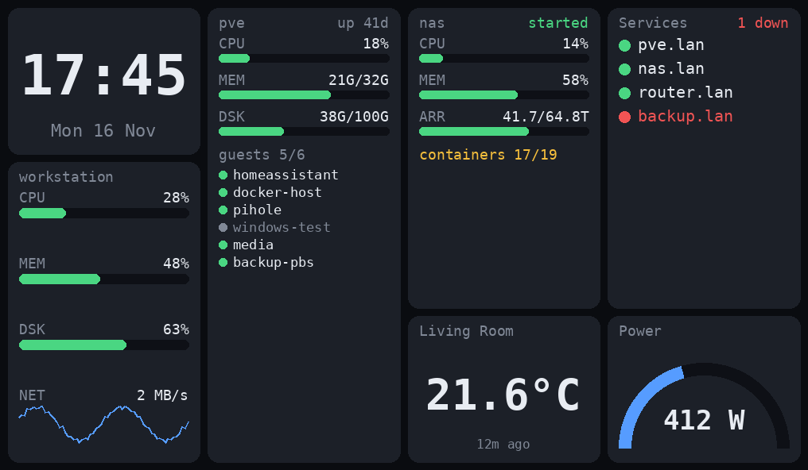
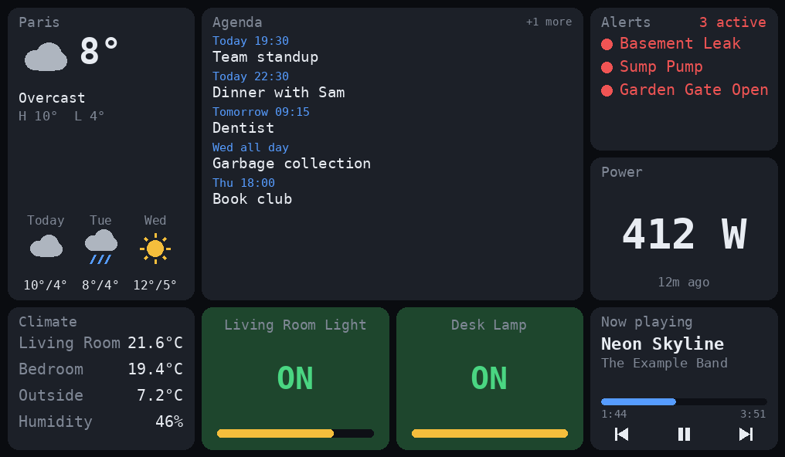
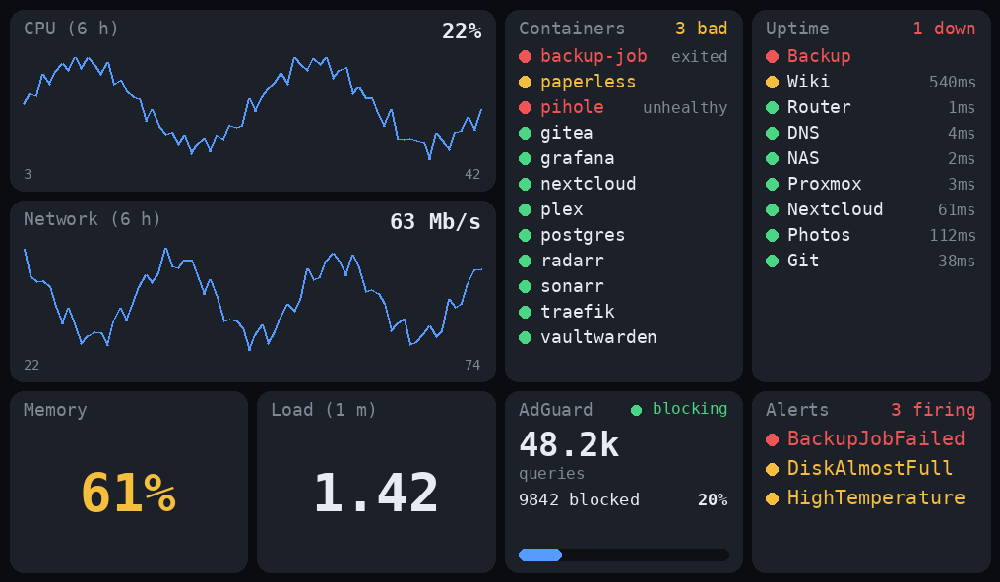
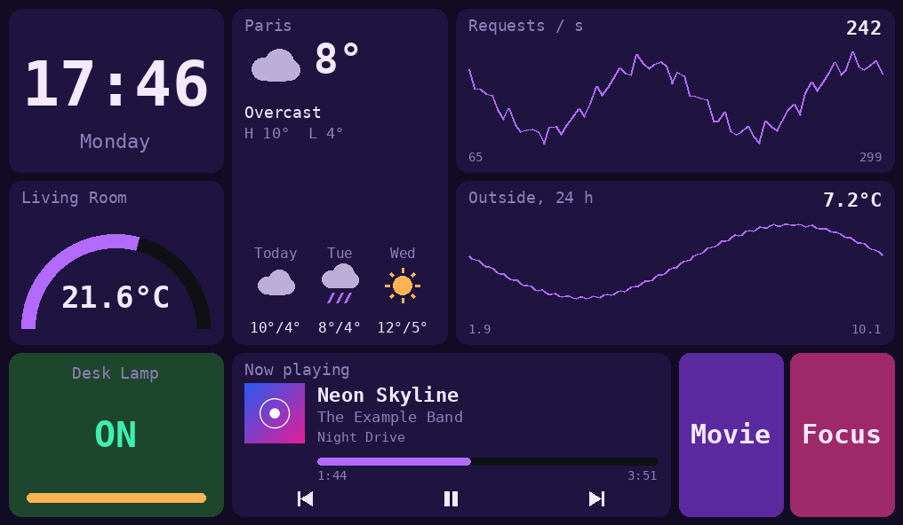
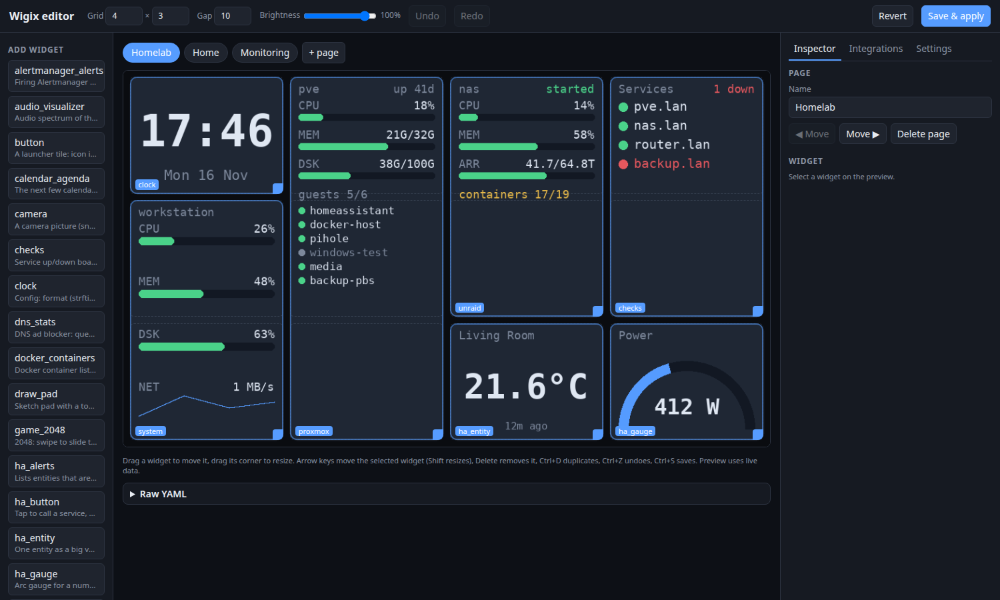

# wigix

[](https://ko-fi.com/brognak)

**A configurable touch dashboard for the G.SKILL WigiDash USB panel on Linux: monitor your machines, control your
smart home, and lay it all out in a browser editor.**



> Every screenshot in this repo is rendered from fake data by [tools/make_screenshots.py](tools/make_screenshots.py)
> (no real services involved). The panel is 1016x592; wigix draws exactly that.

| | |
|---|---|
|  |  |
|  |  |

## Features

- **Open driver** (`wigix.WigiDash`): pushes frames to the panel, reads touch, sets brightness. No vendor software needed.
- **Touch**: tap, swipe between pages, tap a widget to open it fullscreen, raw-touch widgets (sketch pad, games).
- **Web editor** at `http://localhost:8765`: drag and resize widgets over a live preview, edit options, add pages, save. The
  running dashboard hot-reloads.
- **Integrations**: Home Assistant (live over WebSocket), Proxmox, Unraid, Docker, Prometheus, Alertmanager, Uptime Kuma,
  UniFi, Pi-hole, AdGuard Home, any JSON/HTTP API, weather (Open-Meteo, no key), calendars (iCal), media players (MPRIS),
  Bambu Lab printers, cameras and video.
- **Actions**: a tap can switch pages, go fullscreen, open a URL, call a Home Assistant service or (opt-in) run a command or press keys.
- **Splash, screensaver and popups**: startup splash, idle dimming and screensaver, and Home Assistant triggers that pop up
  a widget (for example a doorbell camera).
- **Themes**: change the colors for the whole dashboard or for a single widget.
- **Plugins**: a new widget or integration is one Python file ([docs/writing-plugins.md](docs/writing-plugins.md)).
- **Brightness** and **fullscreen** per config; modest on the CPU (frames are only sent when something changed).

See every widget in the [gallery](docs/gallery.md).

## Quick start

```sh
pipx install git+https://github.com/shatteredeagle/wigix   # Arch package, source and Docker: see docs/install.md
wigix init --udev     # prints the udev rule and commands so your user can open the panel
wigix init            # starter config in ~/.config/wigix/dashboard.yaml
wigix doctor          # checks everything and tells you how to fix problems
wigix run -c ~/.config/wigix/dashboard.yaml   # editor at http://localhost:8765
```

No panel at hand? `wigix preview -c dashboard.yaml -o preview.png` renders page 1 to a PNG. Full walkthrough, systemd
autostart and Docker: [docs/install.md](docs/install.md). Something wrong? [docs/troubleshooting.md](docs/troubleshooting.md).

## A small config

```yaml
integrations:
  ha:
    type: home_assistant
    url: http://homeassistant.local:8123
    token_file: ~/.config/wigix/ha_token      # keep secrets in 0600 files, not in the YAML

pages:
  - name: Overview
    grid: {cols: 4, rows: 3, gap: 10}
    widgets:
      - {type: clock,  at: [0, 0, 1, 1]}                   # at: [column, row, columns wide, rows tall]
      - {type: system, at: [0, 1, 1, 2]}
      - {type: ha_entity, entity: sensor.living_room_temperature, at: [1, 0, 1, 1]}
      - {type: ha_toggle, entity: light.desk_lamp, at: [1, 1, 1, 1]}
      - {type: checks, title: Services, at: [3, 0, 1, 3], checks: [
          {name: "router", http: "http://router.lan"}, {name: "nas", tcp: "nas.lan:445"}]}
```

A complete example is in [examples/dashboard.yaml](examples/dashboard.yaml).

## Widgets and integrations

| Area | Widgets | Docs |
|---|---|---|
| Home Assistant | `ha_entity`, `ha_list`, `ha_toggle`, `ha_button`, `ha_graph`, `ha_gauge`, `ha_alerts` | [home-assistant.md](docs/home-assistant.md) |
| Monitoring | `json_value`, `json_list`, `prom_value`, `prom_graph`, `alertmanager_alerts`, `docker_containers`, `uptime_kuma` | [integrations-monitoring.md](docs/integrations-monitoring.md) |
| Network and personal | `dns_stats`, `unifi`, `weather`, `calendar_agenda`, `media_player` | [integrations-network.md](docs/integrations-network.md) |
| Servers | `system`, `node`, `proxmox`, `unraid`, `checks` | [gallery.md](docs/gallery.md) |
| Pictures and video | `image`, `video`, `camera` | [media-widgets.md](docs/media-widgets.md) |
| Printer and audio | `printer`, `audio_visualizer` | [printer-and-audio.md](docs/printer-and-audio.md) |
| Touch | `button`, `macro_pad`, `draw_pad`, `snake`, `game_2048` | [touch-widgets.md](docs/touch-widgets.md) |
| Basics | `clock`, `text` | [gallery.md](docs/gallery.md) |

## Docs

- [Install and first run](docs/install.md) and [Troubleshooting](docs/troubleshooting.md)
- [Widget gallery](docs/gallery.md) and [the web editor](docs/editor.md)
- [Splash, screensaver and popups](docs/overlays.md)
- [Home Assistant](docs/home-assistant.md), [monitoring integrations](docs/integrations-monitoring.md),
  [network and personal integrations](docs/integrations-network.md)
- [Media widgets](docs/media-widgets.md), [printer and audio](docs/printer-and-audio.md), [touch widgets](docs/touch-widgets.md)
- [Writing widgets and integrations](docs/writing-plugins.md)
- [USB protocol notes](docs/protocol.md)

## Known quirk: replug

After the vendor's Windows software (or a firmware flash) has used the panel, it can sit on its boot logo or a black
screen until you **unplug and replug** the USB cable. A fresh plug-in works. Details:
[docs/install.md](docs/install.md#5-the-replug-quirk).

## Security notes

- The web editor binds to localhost, checks the `Host` header and requires a custom header on writes. Don't expose
  it to a network you don't trust: it can edit the config, and the config can start commands.
- `command:` and key-press actions are ignored unless the config sets `security: {allow_commands: true}`.
- Keep API tokens in files with mode 0600 (`token_file:`), not in the YAML.

## Contributing

Issues and pull requests are welcome; see [CONTRIBUTING.md](CONTRIBUTING.md). Development setup:

```sh
python -m venv .venv && .venv/bin/pip install -e '.[dev]'
.venv/bin/python -m pytest -q tests
.venv/bin/python tools/make_screenshots.py && .venv/bin/python tools/gallery.py   # refresh docs/img and the gallery
```

New widgets appear in the gallery automatically when you re-run `tools/gallery.py`.

## License and disclaimer

Licensed under the [GNU GPL v3](LICENSE).

wigix is an independent project and is **not affiliated with, endorsed by or sponsored by G.SKILL**. "G.SKILL" and
"WigiDash" are trademarks of their owners. The USB protocol was worked out from USB captures of a device the author owns,
for interoperability; no vendor code, firmware or assets are included.

## Support

wigix is free software (GPL-3.0). If it saves you time, you can [buy me a coffee on Ko-fi](https://ko-fi.com/brognak).
