# Widget gallery

Every built-in widget, drawn from fake data by `tools/gallery.py` (regenerate it with `.venv/bin/python tools/gallery.py`). Each picture shows the widget in a 1x1 cell (left) and a 2x2 cell (right) of a 4x3 grid, so you can see how it adapts. Widgets that need a service show a placeholder card when it is missing.

Jump to: [air](#air), [alertmanager_alerts](#alertmanager-alerts), [audio_visualizer](#audio-visualizer), [button](#button), [calendar_agenda](#calendar-agenda), [camera](#camera), [checks](#checks), [clock](#clock), [dns_stats](#dns-stats), [docker_containers](#docker-containers), [draw_pad](#draw-pad), [game_2048](#game-2048), [ha_alerts](#ha-alerts), [ha_button](#ha-button), [ha_entity](#ha-entity), [ha_gauge](#ha-gauge), [ha_graph](#ha-graph), [ha_list](#ha-list), [ha_toggle](#ha-toggle), [image](#image), [json_list](#json-list), [json_value](#json-value), [macro_pad](#macro-pad), [media_player](#media-player), [multi_graph](#multi-graph), [node](#node), [printer](#printer), [prom_graph](#prom-graph), [prom_value](#prom-value), [proxmox](#proxmox), [screensaver](#screensaver), [sensor_graphs](#sensor-graphs), [snake](#snake), [system](#system), [text](#text), [unifi](#unifi), [unraid](#unraid), [uptime_kuma](#uptime-kuma), [video](#video), [weather](#weather)

## air

Radon (graph + weekly average line) and room climate graphs from Home Assistant sensors.

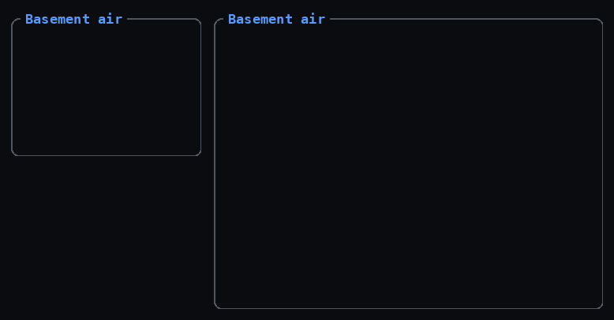

```yaml
- type: air
  at: [0, 0, 1, 1]
  name: Basement air
  hours: 168
  env_hours: 24
  style: btop
```

| option | type | default | description |
|---|---|---|---|
| `name` | string | `Basement air` |  |
| `integration` | string | - | integration name (optional if only one) |
| `radon` | entity | - | radon concentration sensor |
| `radon_avg` | entity | - | its 7-day average sensor (drawn as a dashed line) |
| `temperature` | entity | - | temperature sensor |
| `humidity` | entity | - | humidity sensor |
| `pressure` | entity | - | pressure sensor |
| `hours` | float | `168` | radon graph length in hours (168 = a week) |
| `env_hours` | float | `24` | climate graphs length in hours |
| `warn` | float | - | warning level (default 2.7 pCi/L or 100 Bq/m³) |
| `crit` | float | - | high level (default 4 pCi/L or 148 Bq/m³) |
| `style` | select | `btop` | btop = outlined panel with the title in the border; card = filled card |

## alertmanager_alerts

Firing Alertmanager alerts, most severe first, colored by severity. Needs an `alertmanager` integration.

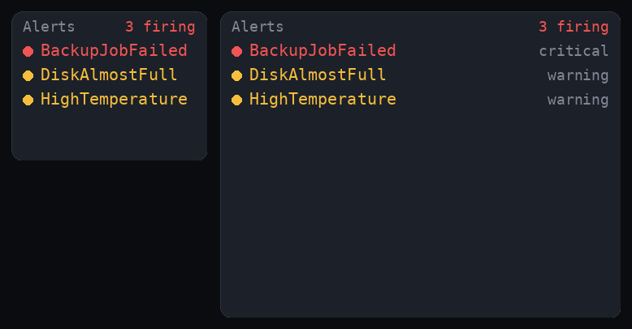

Needs an `alertmanager` integration:

```yaml
integrations:
  main: {type: alertmanager, url: 'http://alertmanager.lan:9093'}
```

```yaml
- type: alertmanager_alerts
  at: [0, 0, 1, 1]
  title: Alerts
```

| option | type | default | description |
|---|---|---|---|
| `title` | string | `Alerts` |  |
| `integration` | string | - | integration name (optional if only one) |

## audio_visualizer

Audio spectrum of the default output (needs parec or pw-record). Options: bars, style bars|wave|line, device.

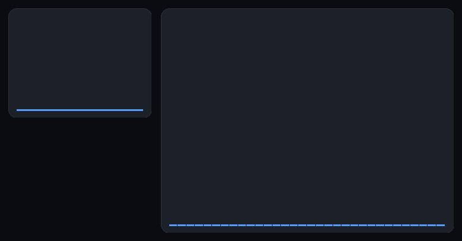

```yaml
- type: audio_visualizer
  at: [0, 0, 1, 1]
  bars: 32
  style: bars
```

| option | type | default | description |
|---|---|---|---|
| `name` | string | - | optional card title |
| `bars` | int | `32` | number of frequency bars |
| `style` | string | `bars` | bars \| wave \| line |
| `device` | string | - | audio source to capture (default: the default output's monitor) |

## button

A launcher tile: icon image and/or label that runs actions on tap (pages, fullscreen, commands, URLs, Home Assistant services). Set the actions with the usual `on_tap` (a single action or a list).

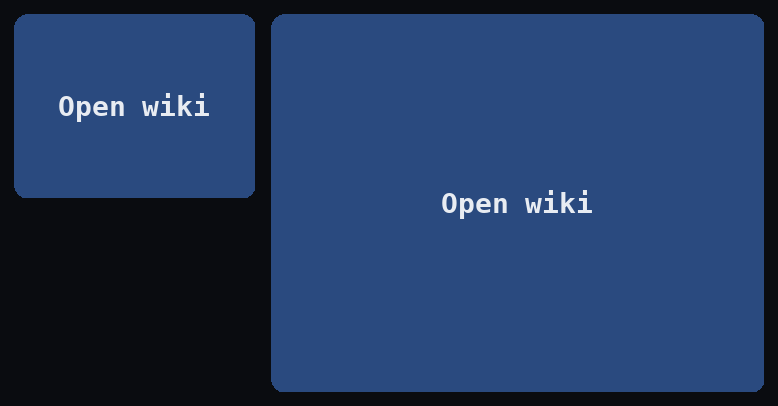

```yaml
- type: button
  at: [0, 0, 1, 1]
  label: Open wiki
  color: '#2a4a7f'
  on_tap: {url: 'https://wiki.example.com'}
```

| option | type | default | description |
|---|---|---|---|
| `label` | string | `Button` |  |
| `icon` | string | - | path to a PNG/JPG icon |
| `color` | color | `#1c2028` | background |

## calendar_agenda

The next few calendar events with relative day labels. Needs an `ical` integration.

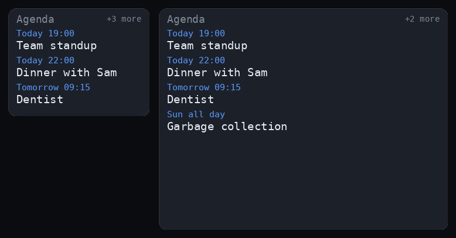

Needs an `ical` integration:

```yaml
integrations:
  main: {type: ical, url_file: ~/.config/wigix/cal_url}
```

```yaml
- type: calendar_agenda
  at: [0, 0, 1, 1]
  max_events: 4
```

| option | type | default | description |
|---|---|---|---|
| `name` | string | `Agenda` |  |
| `integration` | string | - | integration name (optional if only one) |
| `max_events` | int | `4` |  |
| `time_format` | string | `%H:%M` | strftime, e.g. %I:%M %p |

## camera

A camera picture (snapshot, stream, Home Assistant or Frigate) with name and LIVE/stale badge.


```yaml
- type: camera
  at: [0, 0, 1, 1]
  refresh: 2
  verify: true
  fit: cover
  rounded: true
```

| option | type | default | description |
|---|---|---|---|
| `name` | string | - | label drawn over the picture |
| `snapshot_url` | string | - | URL of a JPEG still |
| `stream_url` | string | - | RTSP or MJPEG stream URL |
| `ha_camera` | entity | - | Home Assistant camera entity, e.g. camera.porch |
| `integration` | string | - | Home Assistant integration (optional if only one) |
| `frigate` | string | - | Frigate base URL (or true, with url:) |
| `url` | string | - | Frigate base URL when frigate is true |
| `camera` | string | - | Frigate camera name |
| `refresh` | float | `2` | seconds between snapshots |
| `token` | string | - | bearer token for the snapshot/Frigate server |
| `token_file` | string | - | file holding the bearer token |
| `headers` | yaml | `{}` | extra HTTP headers for snapshots |
| `verify` | bool | `true` | verify TLS certificates: true, false, or a CA bundle path (YAML) |
| `border` | color | - | coloured outline (match it to a graph line) |
| `fit` | string | `cover` | cover (crop to fill) \| contain (letterbox) \| stretch |
| `rounded` | bool | `true` | round the corners like a card |

## checks

Service up/down board. Config: checks: [{name, http: url} | {name, tcp: "host:port"}], timeout.

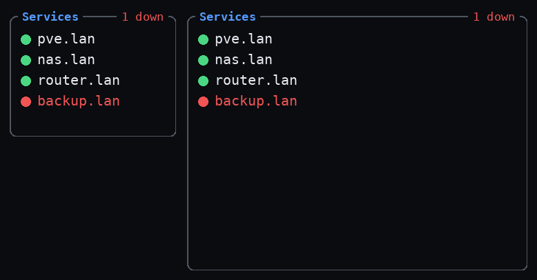

```yaml
- type: checks
  at: [0, 0, 1, 1]
  title: Services
  checks:
  - {name: pve.lan, http: 'http://127.0.0.1:41827/ok'}
  - {name: nas.lan, tcp: '127.0.0.1:51017'}
  - {name: router.lan, http: 'http://127.0.0.1:41827/ok'}
  - {name: backup.lan, tcp: '127.0.0.1:9'}
```

| option | type | default | description |
|---|---|---|---|
| `title` | string | `Services` |  |
| `checks` | yaml | `[{http: 'https://example.com', name: Example}]` | list of {name, http\|tcp} |
| `timeout` | float | `3` |  |
| `style` | select | `btop` | btop = outlined panel with the title in the border; card = filled card |

## clock

Config: format (strftime, default %H:%M), date_format (default %a %b %d).

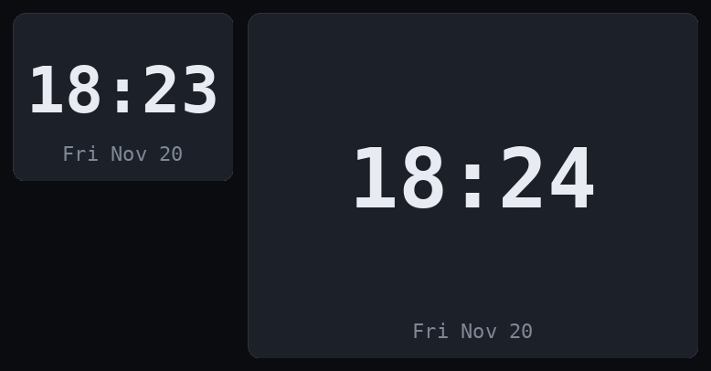

```yaml
- type: clock
  at: [0, 0, 1, 1]
  format: '%H:%M'
  date_format: '%a %b %d'
```

| option | type | default | description |
|---|---|---|---|
| `format` | string | `%H:%M` | strftime format |
| `date_format` | string | `%a %b %d` | strftime format for the date line |

## dns_stats

DNS ad blocker: queries today, blocked count and percentage, on/off state. Needs a `pihole` or `adguard` integration. With `tap_toggle: true` a tap switches Pi-hole v6 blocking on/off.

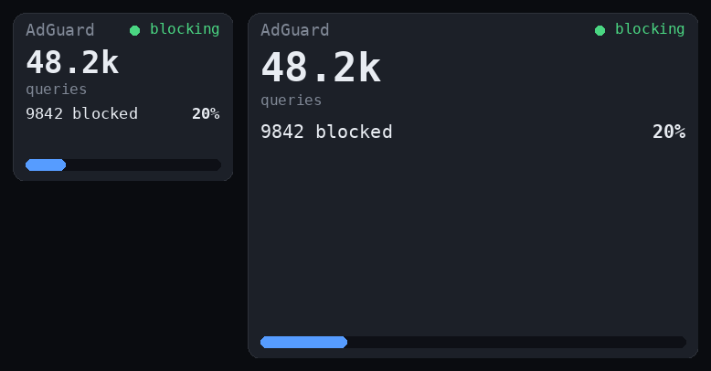

Needs an `adguard` integration:

```yaml
integrations:
  main: {type: adguard, url: 'http://adguard.lan', username: admin, password_file: ~/.config/wigix/adguard_pw}
```

```yaml
- type: dns_stats
  at: [0, 0, 1, 1]
  tap_toggle: false
```

| option | type | default | description |
|---|---|---|---|
| `name` | string | - | title (defaults to Pi-hole / AdGuard) |
| `integration` | string | - | integration name (optional if only one Pi-hole/AdGuard) |
| `tap_toggle` | bool | `false` | tap switches blocking on/off (Pi-hole v6 only) |

## docker_containers

Docker container list with state dots and running/problem counts. Needs a `docker` integration.

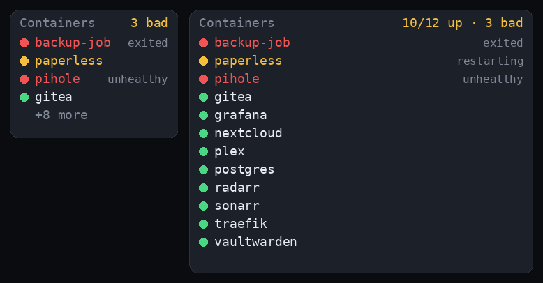

Needs a `docker` integration:

```yaml
integrations:
  main: {type: docker, socket: /var/run/docker.sock}
```

```yaml
- type: docker_containers
  at: [0, 0, 1, 1]
  title: Containers
  only_problems: false
  max_rows: 12
```

| option | type | default | description |
|---|---|---|---|
| `title` | string | `Containers` |  |
| `integration` | string | - | integration name (optional if only one) |
| `only_problems` | bool | `false` | hide healthy running containers |
| `names` | lines | `[]` | only these containers (wildcards ok, e.g. media-*) |
| `max_rows` | int | `12` |  |

## draw_pad

Sketch pad with a toolbar (colors, three brush sizes, eraser, clear, save).

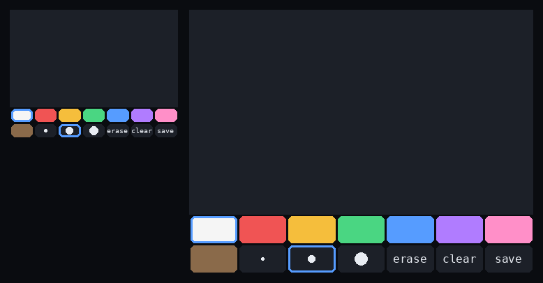

```yaml
- type: draw_pad
  at: [0, 0, 1, 1]
  save_dir: ~/Pictures/wigix
```

| option | type | default | description |
|---|---|---|---|
| `save_dir` | string | `~/Pictures/wigix` | folder for saved PNGs |

## game_2048

2048: swipe to slide the tiles, tap to restart after game over. Use `on_tap: fullscreen` to open it.

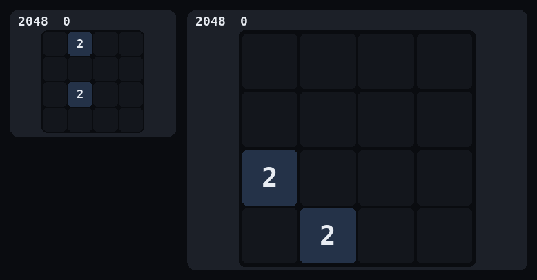

```yaml
- type: game_2048
  at: [0, 0, 1, 1]
```

## ha_alerts

Lists entities that are alerting. Explicit `entities` and/or a scan of `domains` + `device_classes` (default: binary_sensors reporting problem/safety/smoke/gas/moisture/co/heat/cold/tamper).

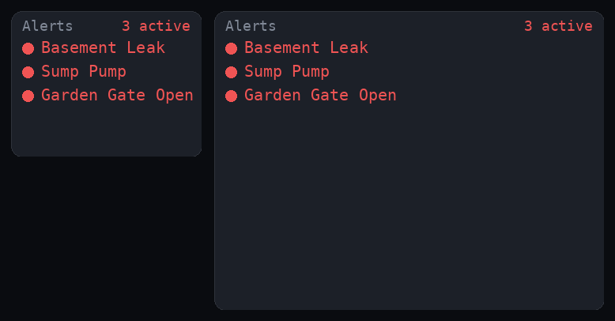

```yaml
- type: ha_alerts
  at: [0, 0, 1, 1]
  title: Alerts
  scan: true
  alert_states: ['on']
```

| option | type | default | description |
|---|---|---|---|
| `title` | string | `Alerts` |  |
| `integration` | string | - | integration name (optional if only one) |
| `entities` | lines | `[]` | entity ids that alert when state is in alert_states |
| `scan` | bool | `true` | also scan problem-type binary sensors |
| `alert_states` | yaml | `['on']` | states that count as alerting |

## ha_button

Tap to call a service, e.g. scene.turn_on or script.turn_on with an entity, or any service with data.

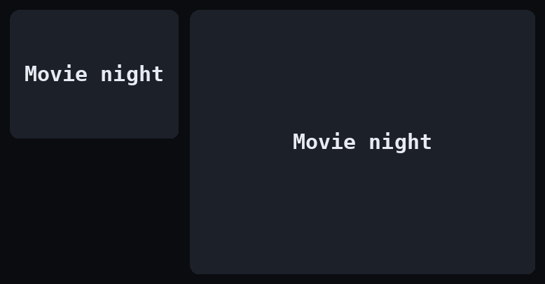

```yaml
- type: ha_button
  at: [0, 0, 1, 1]
  label: Movie night
  service: scene.turn_on
  entity: scene.movie_night
```

| option | type | default | description |
|---|---|---|---|
| `label` | string | `Run` |  |
| `integration` | string | - | integration name (optional if only one) |
| `service` | string | `scene.turn_on` | domain.service |
| `entity` | entity | - | Home Assistant entity id |
| `data` | yaml | `{}` | extra service data |

## ha_entity

One entity as a big value with a "changed 3m ago" line. Tap a numeric one to flip to its history graph (unless the widget has its own `on_tap`). `hours` sets the graph span.

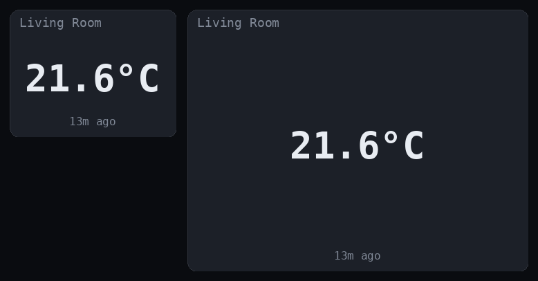

```yaml
- type: ha_entity
  at: [0, 0, 1, 1]
  entity: sensor.living_room_temperature
  precision: 1
```

| option | type | default | description |
|---|---|---|---|
| `entity` | entity | - | Home Assistant entity id |
| `name` | string | - | label (defaults to the friendly name) |
| `integration` | string | - | integration name (optional if only one) |
| `unit` | string | - |  |
| `precision` | int | - |  |
| `hours` | float | `24` |  |
| `color_rules` | yaml | `[]` | e.g. [{"above": 80, "color": "#f05454"}] |

## ha_gauge

Arc gauge for a numeric entity between min and max.

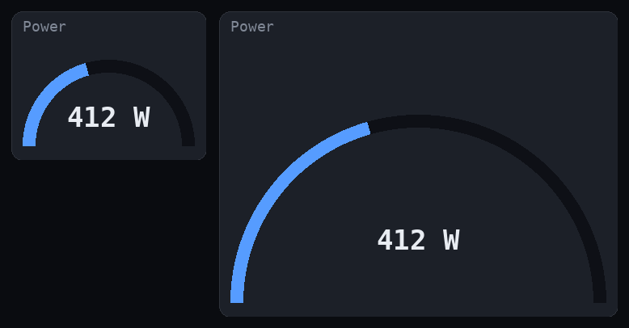

```yaml
- type: ha_gauge
  at: [0, 0, 1, 1]
  entity: sensor.power_consumption
  min: 0
  max: 1000
```

| option | type | default | description |
|---|---|---|---|
| `entity` | entity | - | Home Assistant entity id |
| `name` | string | - | label (defaults to the friendly name) |
| `integration` | string | - | integration name (optional if only one) |
| `min` | float | `0` |  |
| `max` | float | `100` |  |
| `unit` | string | - |  |
| `precision` | int | - |  |
| `color_rules` | yaml | `[]` | e.g. [{"above": 80, "color": "#f05454"}] |

## ha_graph

History sparkline for a numeric entity, with current value and min/max.

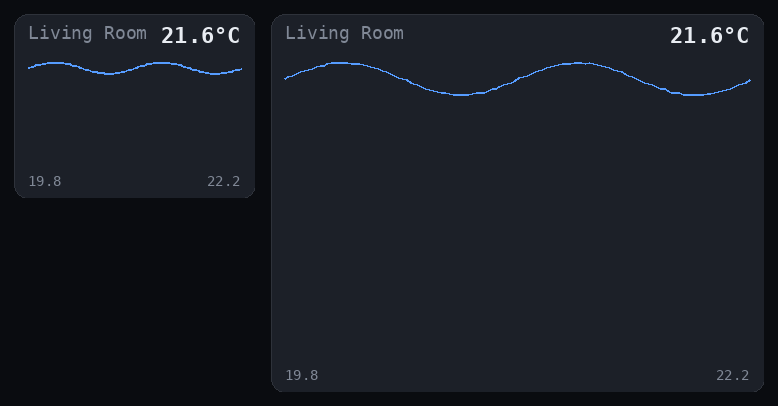

```yaml
- type: ha_graph
  at: [0, 0, 1, 1]
  entity: sensor.living_room_temperature
  hours: 24
  precision: 1
```

| option | type | default | description |
|---|---|---|---|
| `entity` | entity | - | Home Assistant entity id |
| `name` | string | - | label (defaults to the friendly name) |
| `integration` | string | - | integration name (optional if only one) |
| `hours` | float | `24` |  |
| `unit` | string | - |  |
| `precision` | int | - |  |
| `color_rules` | yaml | `[]` | e.g. [{"above": 80, "color": "#f05454"}] |

## ha_list

Several entities as rows: name left, value right.

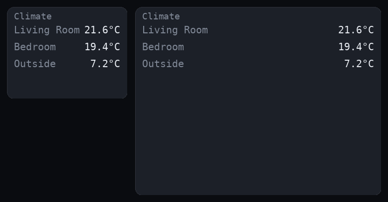

```yaml
- type: ha_list
  at: [0, 0, 1, 1]
  title: Climate
  entities: [sensor.living_room_temperature, sensor.bedroom_temperature, sensor.outdoor_temperature]
```

| option | type | default | description |
|---|---|---|---|
| `title` | string | - |  |
| `integration` | string | - | integration name (optional if only one) |
| `entities` | lines | `[]` | one entity id per line |
| `color_rules` | yaml | `[]` | e.g. [{"above": 80, "color": "#f05454"}] |

## ha_toggle

Tap to toggle a light, switch, fan, input_boolean, ... Shows brightness for dimmable lights.

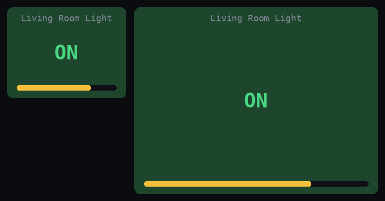

```yaml
- type: ha_toggle
  at: [0, 0, 1, 1]
  entity: light.living_room
```

| option | type | default | description |
|---|---|---|---|
| `entity` | entity | - | Home Assistant entity id |
| `name` | string | - | label (defaults to the friendly name) |
| `integration` | string | - | integration name (optional if only one) |

## image

A picture or animated GIF from a file or URL, scaled to the widget (cover, contain or stretch).


```yaml
- type: image
  at: [0, 0, 1, 1]
  fit: cover
  refresh: 300
  rounded: true
```

| option | type | default | description |
|---|---|---|---|
| `source` | string | - | file path or http(s) URL (PNG, JPEG, GIF, ...) |
| `fit` | string | `cover` | cover (crop to fill) \| contain (letterbox) \| stretch |
| `refresh` | int | `300` | seconds between re-downloads of a URL |
| `rounded` | bool | `true` | round the corners like a card |
| `name` | string | - | label drawn over the picture |

## json_list

Rows from a JSON list (or object): a name on the left, a value on the right. Needs an `http` integration.

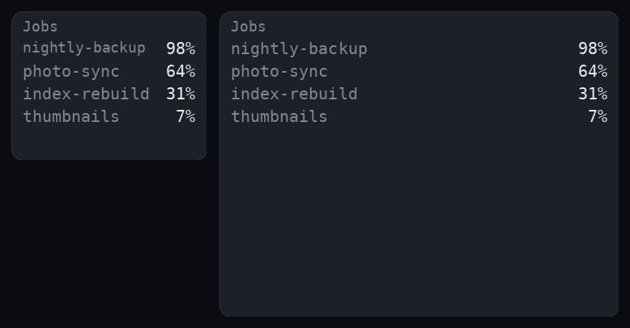

Needs a `http` integration:

```yaml
integrations:
  main: {type: http, base_url: 'http://api.lan:8080', token_file: ~/.config/wigix/api_token}
```

```yaml
- type: json_list
  at: [0, 0, 1, 1]
  title: Jobs
  request: /v1/jobs
  path: jobs
  name_path: name
  value_path: value
  unit: '%'
```

| option | type | default | description |
|---|---|---|---|
| `title` | string | - |  |
| `integration` | string | - | integration name (optional if only one) |
| `request` | string | - | polled URL path, e.g. /v1/queue |
| `path` | string | - | path to the list (or object) in the JSON |
| `name_path` | string | `name` | path to the label inside each item |
| `value_path` | string | `value` | path to the value inside each item |
| `max_rows` | int | `8` |  |
| `unit` | string | - |  |
| `precision` | int | - | decimal places |
| `color_rules` | yaml | `[]` | e.g. [{"above": 80, "color": "#f05454"}] |

## json_value

One value from a JSON API response as a big number or text. Needs an `http` integration.

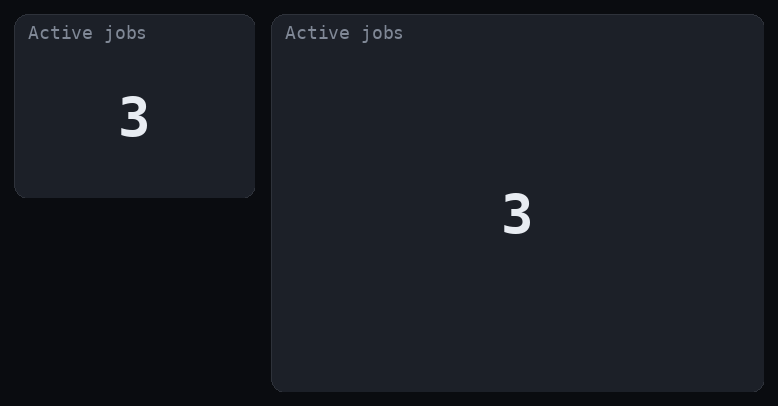

Needs a `http` integration:

```yaml
integrations:
  main: {type: http, base_url: 'http://api.lan:8080', token_file: ~/.config/wigix/api_token}
```

```yaml
- type: json_value
  at: [0, 0, 1, 1]
  name: Active jobs
  request: /v1/stats
  path: queue.active
```

| option | type | default | description |
|---|---|---|---|
| `name` | string | - | card title |
| `integration` | string | - | integration name (optional if only one) |
| `request` | string | - | polled URL path, e.g. /v1/stats |
| `path` | string | - | where in the JSON, e.g. data.items[0].name |
| `unit` | string | - |  |
| `precision` | int | - | decimal places |
| `color_rules` | yaml | `[]` | e.g. [{"above": 80, "color": "#f05454"}] |
| `state_colors` | yaml | `{}` | text value -> color, e.g. {"ok": "#4ad682"} |

## macro_pad

A grid of launcher buttons. Each button runs any `on_tap` action (pages, fullscreen, commands, key presses, typed text, URLs, Home Assistant services, or a list of those).

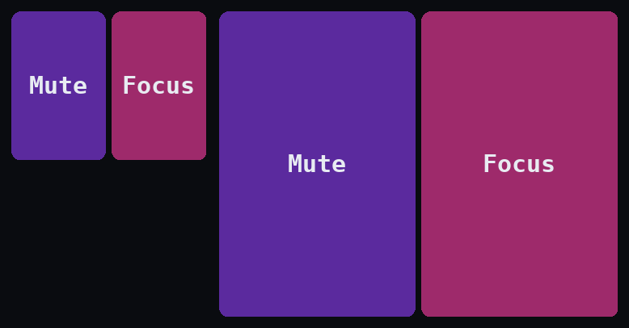

```yaml
- type: macro_pad
  at: [0, 0, 1, 1]
  columns: 2
  buttons:
  - {label: Mute, color: '#5b2a9e', on_tap: next_page}
  - {label: Focus, color: '#9e2a6b', on_tap: fullscreen}
```

| option | type | default | description |
|---|---|---|---|
| `columns` | int | `4` |  |
| `buttons` | yaml | `[]` | list of {label, icon, color, on_tap, toggle: {ha_entity}} |

## media_player

Now playing with progress and cover art; tap the left third for previous, the middle for play/pause, the right third for next. Needs an `mpris` integration (Linux, playerctl).

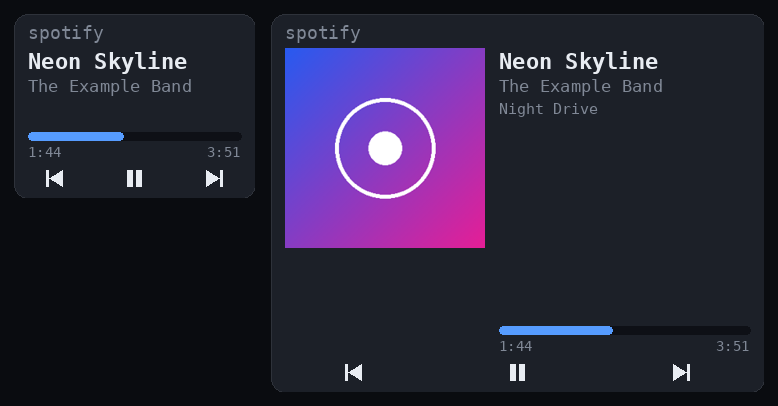

Needs a `mpris` integration:

```yaml
integrations:
  main: {type: mpris}
```

```yaml
- type: media_player
  at: [0, 0, 1, 1]
  art: true
```

| option | type | default | description |
|---|---|---|---|
| `name` | string | - |  |
| `integration` | string | - | integration name (optional if only one) |
| `art` | bool | `true` | show cover art when the card is big enough |

## multi_graph

One graph per group, one coloured line per sensor, with a legend of the current values.

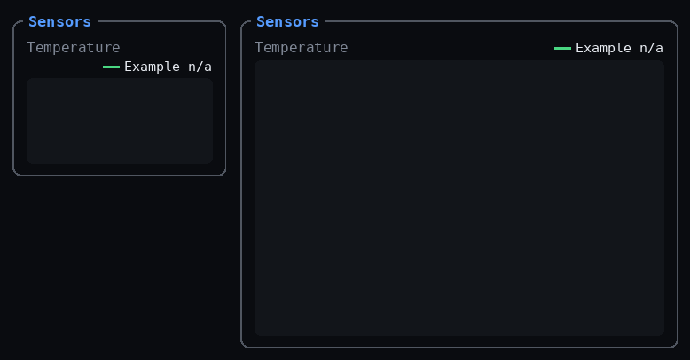

```yaml
- type: multi_graph
  at: [0, 0, 1, 1]
  graphs:
  - title: Temperature
    series:
    - {entity: sensor.example, label: Example, color: '#4ad682'}
  hours: 24
  style: btop
```

| option | type | default | description |
|---|---|---|---|
| `name` | string | - |  |
| `integration` | string | - | integration name (optional if only one) |
| `graphs` | yaml | `[{series: [{color: '#4ad682', entity: sensor.example, label: Example}], title: Temperature}]` | list of {title, series: [{entity, label, color (#rrggbb), dashed}]} |
| `hours` | float | `24` | graph length in hours |
| `style` | select | `btop` | btop = outlined panel with the title in the border; card = filled card |

## node

A remote machine via Prometheus node_exporter. Config: url (e.g. http://nas.lan:9100/metrics), name.

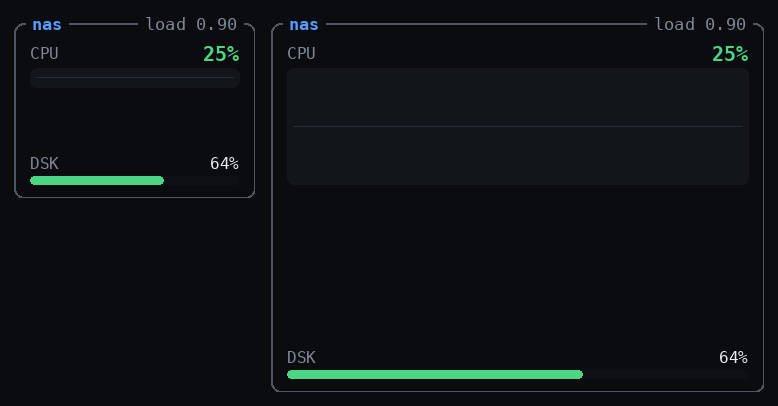

```yaml
- type: node
  at: [0, 0, 1, 1]
  name: nas
  url: http://nas.lan:9100/metrics
```

| option | type | default | description |
|---|---|---|---|
| `name` | string | - |  |
| `url` | string | `http://host:9100/metrics` | node_exporter metrics URL |
| `style` | select | `btop` | btop = outlined panel with the title in the border; card = filled card |

## printer

Bambu Lab 3D printer: state, job, progress, time left, layers and temperatures. Needs a `bambu` integration.

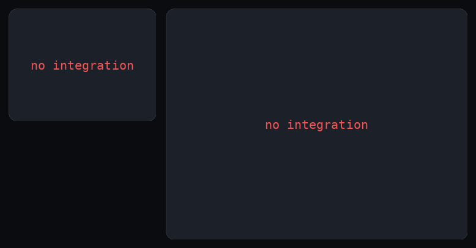

Needs a `bambu` integration:

```yaml
integrations:
  main: {type: bambu}
```

```yaml
- type: printer
  at: [0, 0, 1, 1]
  name: Printer
```

| option | type | default | description |
|---|---|---|---|
| `name` | string | `Printer` | card title |
| `integration` | string | - | integration name (optional if only one) |

## prom_graph

Sparkline of a Prometheus range query with the current value and min/max. Needs a `prometheus` integration.

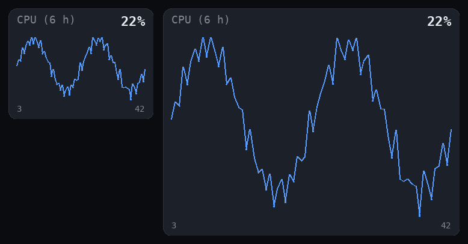

Needs a `prometheus` integration:

```yaml
integrations:
  main:
    type: prometheus
    url: http://prometheus.lan:9090
    queries: {mem: avg(node_memory_used_percent)}
    ranges:
      cpu_hist: {query: avg(cpu_percent), hours: 6}
```

```yaml
- type: prom_graph
  at: [0, 0, 1, 1]
  range: cpu_hist
  name: CPU (6 h)
  unit: '%'
  precision: 0
```

| option | type | default | description |
|---|---|---|---|
| `range` | string | - | name of an entry under ranges: |
| `name` | string | - | card title |
| `integration` | string | - | integration name (optional if only one) |
| `unit` | string | - |  |
| `precision` | int | - | decimal places |
| `color_rules` | yaml | `[]` | e.g. [{"above": 80, "color": "#f05454"}] |

## prom_value

One Prometheus query as a big value with a unit and color rules. Needs a `prometheus` integration.

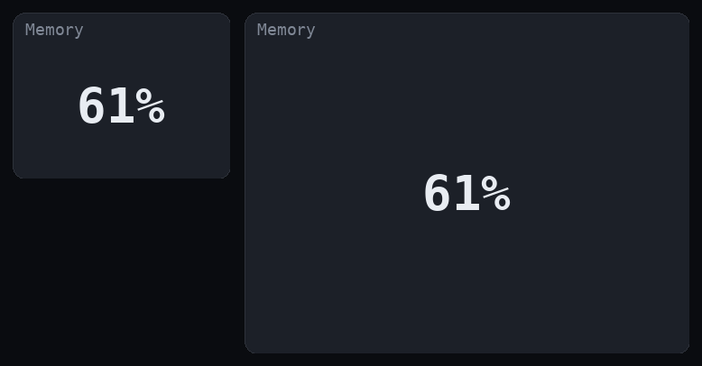

Needs a `prometheus` integration:

```yaml
integrations:
  main:
    type: prometheus
    url: http://prometheus.lan:9090
    queries: {mem: avg(node_memory_used_percent)}
    ranges:
      cpu_hist: {query: avg(cpu_percent), hours: 6}
```

```yaml
- type: prom_value
  at: [0, 0, 1, 1]
  query: mem
  name: Memory
  unit: '%'
  precision: 0
```

| option | type | default | description |
|---|---|---|---|
| `query` | string | - | name of an entry under queries: |
| `name` | string | - | card title |
| `integration` | string | - | integration name (optional if only one) |
| `unit` | string | - |  |
| `precision` | int | - | decimal places |
| `color_rules` | yaml | `[]` | e.g. [{"above": 80, "color": "#f05454"}] |

## proxmox

Proxmox node, btop style: CPU and memory graphs (last 10 minutes), disk meter, and the guest list with load. Needs a `proxmox` integration.

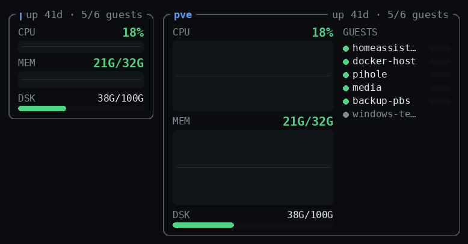

Needs a `proxmox` integration:

```yaml
integrations:
  main: {type: proxmox, url: 'https://pve.lan:8006', token_id: monitor@pve!wigix, token_file: ~/.config/wigix/pve_token}
```

```yaml
- type: proxmox
  at: [0, 0, 1, 1]
  name: pve
```

| option | type | default | description |
|---|---|---|---|
| `name` | string | - | title (defaults to the node name) |
| `integration` | string | - | integration name (optional if only one) |
| `style` | select | `btop` | btop = outlined panel with the title in the border; card = filled card |

## screensaver

Idle-screen art that drifts slowly (so the same pixels never stay lit): the project name and the time.

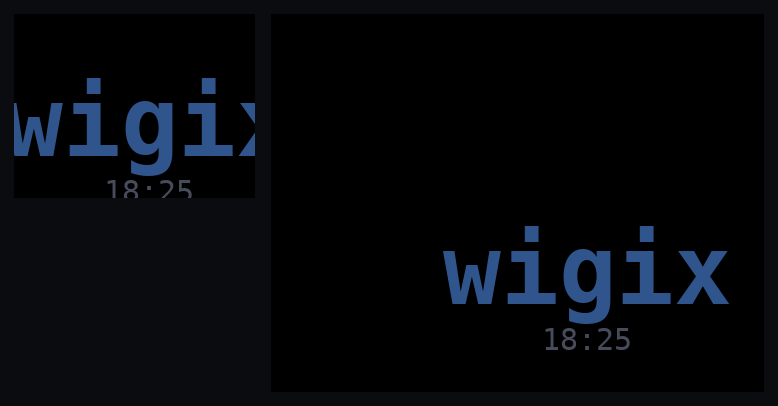

```yaml
- type: screensaver
  at: [0, 0, 1, 1]
  text: wigix
  style: bounce
```

| option | type | default | description |
|---|---|---|---|
| `text` | string | `wigix` |  |
| `style` | select | `bounce` |  |

## sensor_graphs

Each sensor as a labelled graph with its current value; optional battery level in the title. `sensors: [{entity: sensor.frog_temperature, label: Warm}, ...]`.

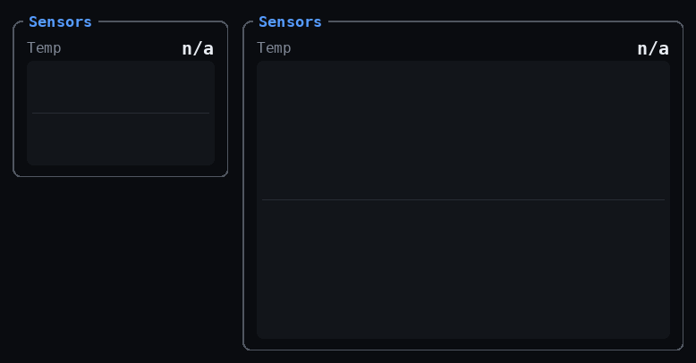

```yaml
- type: sensor_graphs
  at: [0, 0, 1, 1]
  sensors:
  - {entity: sensor.example, label: Temp}
  hours: 24
  style: btop
```

| option | type | default | description |
|---|---|---|---|
| `name` | string | - |  |
| `integration` | string | - | integration name (optional if only one) |
| `sensors` | yaml | `[{entity: sensor.example, label: Temp}]` | list of {entity, label, color (a theme name: accent, ok, warn, crit)} |
| `battery` | entity | - | battery sensor shown in the title (optional) |
| `hours` | float | `24` | graph length in hours |
| `style` | select | `btop` | btop = outlined panel with the title in the border; card = filled card |

## snake

Snake: swipe to steer, tap to restart after game over. Runs only while fullscreen. Config: `speed` (seconds per move, default 0.2). Use `on_tap: fullscreen` to open it.

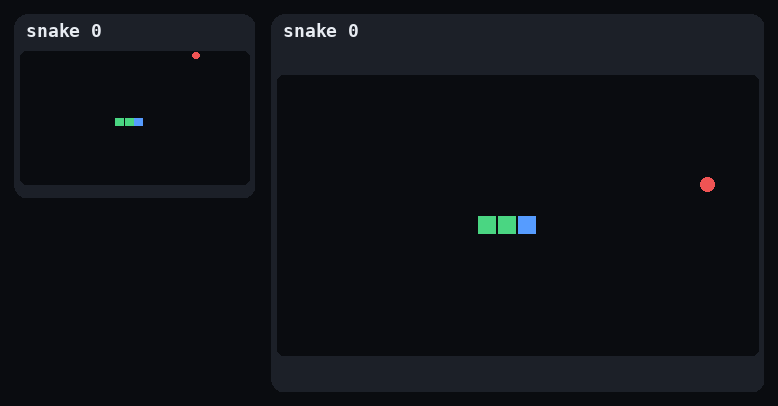

```yaml
- type: snake
  at: [0, 0, 1, 1]
  speed: 0.2
```

| option | type | default | description |
|---|---|---|---|
| `speed` | float | `0.2` | seconds per move |

## system

btop-style panel for THIS machine: CPU, memory and network graphs plus a disk meter.

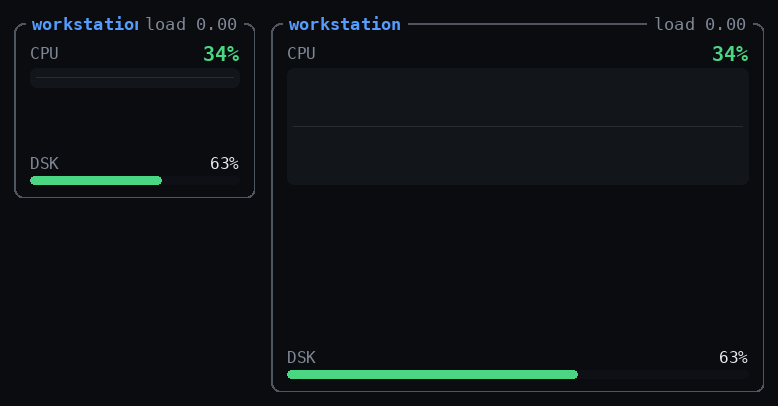

```yaml
- type: system
  at: [0, 0, 1, 1]
  title: workstation
```

| option | type | default | description |
|---|---|---|---|
| `title` | string | - | defaults to the hostname |
| `disk` | string | `/` | mount point for the disk meter |
| `gpu` | bool | `true` | show a GPU graph when one is found (AMD or NVIDIA) |
| `style` | select | `btop` | btop = outlined panel with the title in the border; card = filled card |

## text

Config: text, size (default 28), color (hex).

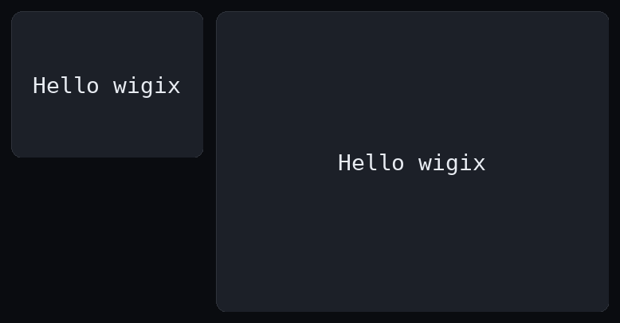

```yaml
- type: text
  at: [0, 0, 1, 1]
  text: Hello wigix
  size: 28
```

| option | type | default | description |
|---|---|---|---|
| `text` | string | - | text to show |
| `size` | int | `28` |  |
| `color` | color | `#e8ecf2` |  |
| `title` | string | - |  |

## unifi

UniFi network: WAN status, up/down throughput, client counts and devices online. Needs a `unifi` integration.

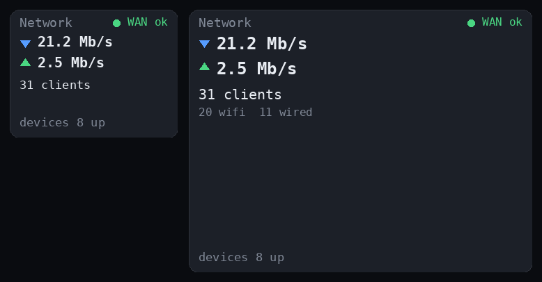

Needs an `unifi` integration:

```yaml
integrations:
  main: {type: unifi, url: 'https://unifi.lan', username: wigix, password_file: ~/.config/wigix/unifi_pw}
```

```yaml
- type: unifi
  at: [0, 0, 1, 1]
  name: Network
```

| option | type | default | description |
|---|---|---|---|
| `name` | string | `Network` |  |
| `integration` | string | - | integration name (optional if only one) |

## unraid

Unraid server, btop style: CPU and memory graphs (last 10 minutes), array usage and container counts. Needs an `unraid` integration.

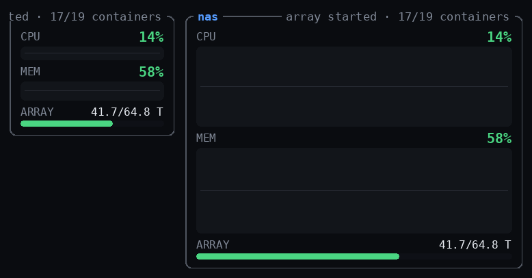

Needs an `unraid` integration:

```yaml
integrations:
  main: {type: unraid, url: 'https://nas.lan/graphql', api_key_file: ~/.config/wigix/unraid_key}
```

```yaml
- type: unraid
  at: [0, 0, 1, 1]
  name: nas
```

| option | type | default | description |
|---|---|---|---|
| `name` | string | `Unraid` |  |
| `integration` | string | - | integration name (optional if only one) |
| `style` | select | `btop` | btop = outlined panel with the title in the border; card = filled card |

## uptime_kuma

Uptime Kuma monitors as dots and names with the latest ping. Needs an `uptime_kuma` integration.

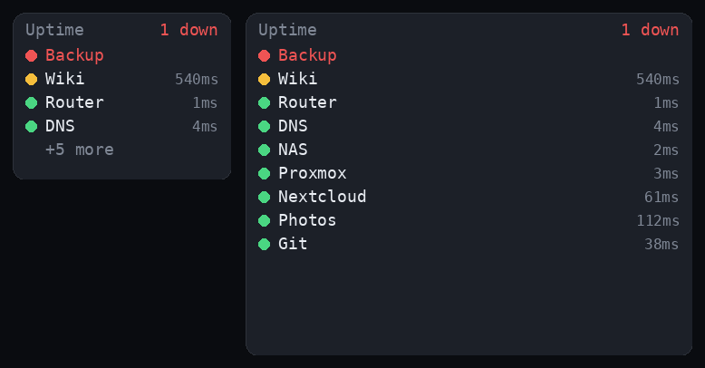

Needs an `uptime_kuma` integration:

```yaml
integrations:
  main: {type: uptime_kuma, url: 'https://kuma.example.com', slug: main}
```

```yaml
- type: uptime_kuma
  at: [0, 0, 1, 1]
  title: Uptime
  only_problems: false
```

| option | type | default | description |
|---|---|---|---|
| `title` | string | `Uptime` |  |
| `integration` | string | - | integration name (optional if only one) |
| `only_problems` | bool | `false` | hide monitors that are up |

## video

A video file or live stream (no sound), decoded by ffmpeg while the page is visible.

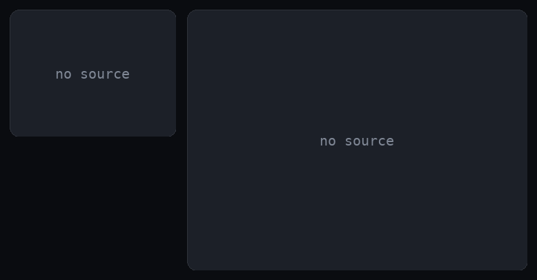

```yaml
- type: video
  at: [0, 0, 1, 1]
  fps: 12
  loop: true
  fit: cover
  rounded: true
```

| option | type | default | description |
|---|---|---|---|
| `source` | string | - | video file or stream URL (rtsp://, http://, ...) |
| `fps` | int | `12` | frames per second to render (max 15) |
| `loop` | bool | `true` | restart a file when it ends |
| `fit` | string | `cover` | cover (crop to fill) \| contain (letterbox) \| stretch |
| `rounded` | bool | `true` | round the corners like a card |
| `name` | string | - | label drawn over the picture |

## weather

Current weather and a 3-day forecast. Needs an `open_meteo` integration.

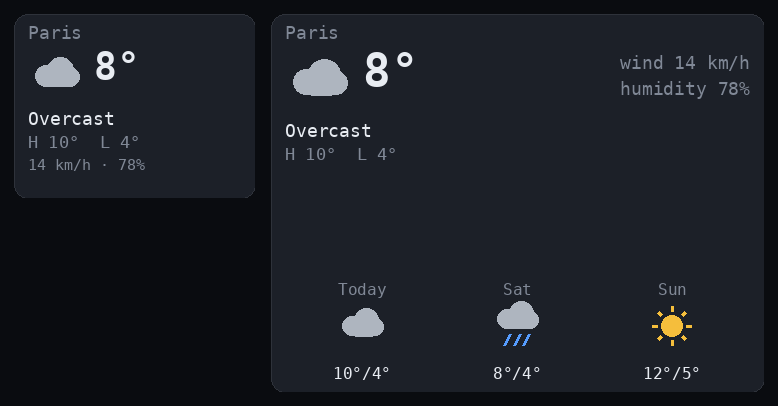

Needs an `open_meteo` integration:

```yaml
integrations:
  main: {type: open_meteo, latitude: 48.85, longitude: 2.35}
```

```yaml
- type: weather
  at: [0, 0, 1, 1]
  name: Paris
```

| option | type | default | description |
|---|---|---|---|
| `name` | string | `Weather` | title, e.g. the city |
| `integration` | string | - | integration name (optional if only one) |
| `forecast` | bool | `true` | show the 3-day row when the card is tall enough |
